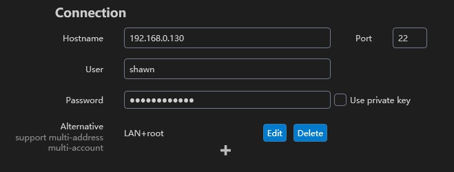
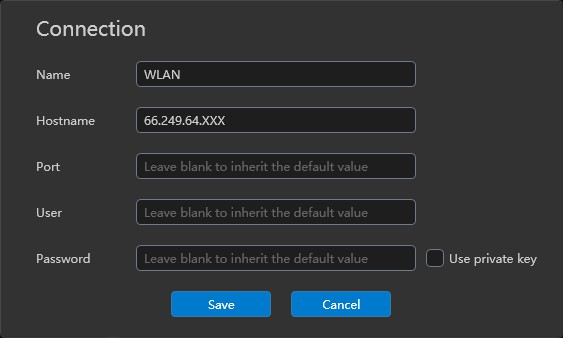
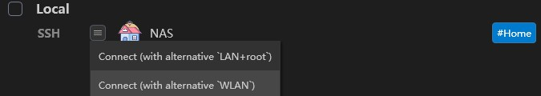
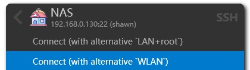
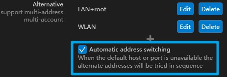
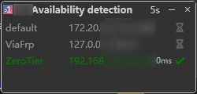

# Alternative credentials

A server entry holds one address, one port and one set of login data. **Alternative credentials** add more of them to the same entry: another address, another account or both. You pick one by hand when you connect, or let {{appname}} take the first address that answers. This spares you a second entry for the same machine.

Two typical cases:

- You connect to a server with a normal account most of the time, and with the root account for maintenance work.
- You reach your NAS by its LAN address at home and by its WAN address from outside.

## Add an alternative credential

1. Open the server with **`Edit`**. The section **`Alternative`** sits under the protocol settings; it says *support multi-address multi-account*.
2. Click **`+`** under the list. A dialog opens.
3. **`Name`** is required. It is what you pick from later, for example `root` or `WAN`. Every other field may stay empty; an empty field takes the value of the server entry (the dialog says *Leave blank to inherit the default value*).
4. Fill in what is different: **`Hostname`** and **`Port`** for another address, **`User`** and **`Password`** for another account. For SSH, SFTP and the like, tick **`Use private key`** to enter a key file instead of a password.
5. Click **`Save`**. The credential shows up in the list; **`Edit`** and **`Delete`** are next to it.

The section exists for RDP, RemoteApp, SSH, SFTP, FTP, VNC and Telnet entries. An APP entry (a program started by {{appname}}, see [APP](protocol/especial/app.md)) gets it as soon as one of its arguments uses the connection macros.

## Connect with one of them

- In the main window: right-click the server and choose **``Connect (with alternative `root`)``**. There is one such line per alternative credential.
- In the launcher: select the server and press ++right++ to open the action list; the same lines are in it. ++left++ closes the list.
- A double-click still connects with the default data.

When the credential you pick has its own address, {{appname}} connects to that address, whether automatic switching is on or not.

## Automatic address switching

Tick **`Automatic address switching`** under the list; the box is enabled as soon as one alternative credential exists. From then on {{appname}} tries the alternative addresses when the default address does not answer, and uses the first one that answers. You no longer switch between LAN and WAN by hand.

What happens when you connect:

1. {{appname}} tries to open a TCP connection to the default address for 0.1 seconds. When it answers, the session starts at once; nothing else is shown.
2. Otherwise the window `<server>: Availability detection` opens with one line per address and a countdown of 5 seconds. A line turns **green** (with the time it took) when the address answers, **red** when the connection is refused, and pale grey when there is no answer in time.
3. The first address that answers wins: the window closes and the session starts with it.
4. When no address answers within 5 seconds, the window shows ``We are not able to connect to `<server>`!`` and no session starts.

The two buttons in the title bar of the window:

- **`_`**: hide the window and let the test go on in the background. The session starts when an address answers.
- **`✕`** (red): stop the test and do not connect.

!!! note
    The test is a plain TCP connection to the address and port of the entry. A server that silently drops packets counts as "no answer", so you wait the full 5 seconds; a server that refuses the connection is reported at once.

## Check the address before connecting

The option **`Availability detection`** -> **`Check if address is available before connect`** sits under **`Hostname`** and **`Port`** of every server. It runs the steps above before every connection, with the default address alone (and the alternative addresses when automatic switching is on): when no address answers within 5 seconds, you get the message above instead of a session that hangs until the protocol gives up. RDP entries that use a Remote Desktop Gateway never run the check, because their address is reached through the gateway.


