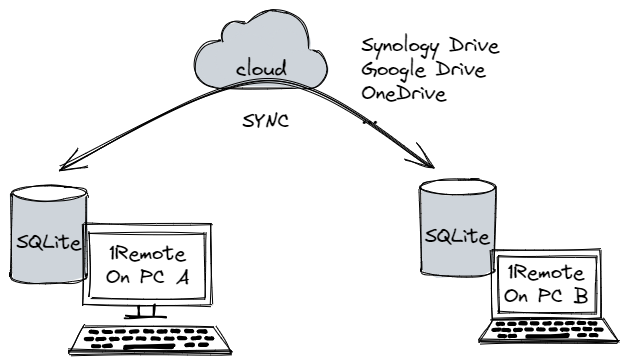
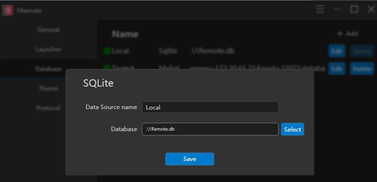
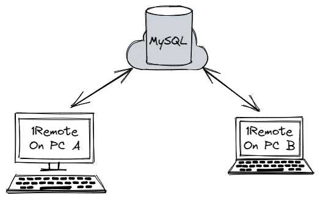
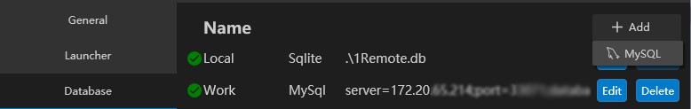

You can manage your servers on several devices, and keep the same server list on all of them. This page shows where {{appname}} keeps its data and the three ways to share it: a json export, a synced SQLite file, or an online database.

## Where your data is

{{appname}} keeps its data in one of two places, depending on the mode you chose on the first start (see [Run it](/download/#run-it)):

| What                                   | Portable mode (data in the program folder)  | AppData mode                                           |
| :------------------------------------- | :----------------------------------------- | :----------------------------------------------------- |
| Settings                               | `<program folder>\1Remote.json`            | `%AppData%\1Remote\1Remote.json`                       |
| List of data sources                   | `<program folder>\1Remote.dataSources.json` | `%AppData%\1Remote\1Remote.dataSources.json`          |
| The default database `Local` (SQLite)  | `<program folder>\1Remote.db`              | `%AppData%\1Remote\1Remote.db`                         |
| Local data: window positions, icons, logs, Quick Connect history | `<program folder>\.locality\` | `%LocalAppData%\1Remote\.locality\`        |

In portable mode the whole program folder is your data: copy it and you have everything. In AppData mode you only need the two `.json` files and the `.db` file to move your servers to another PC.

## By export

1. Select the servers you want, click **`Export`** at the bottom of the main window and save the json file.
2. Copy the file to the other device.
3. On the other device click **`+`** -> **`Import`** -> **`import json`**.

!!! warning inline end
    The json file contains all passwords in plain text.

## By a synced SQLite file

- Our main database is a SQLite database that does not lock the file, so you can copy it while {{appname}} is running.
- Every 10 seconds {{appname}} checks whether the database file was changed by someone else (it compares a change timestamp inside the database). If so, it reloads the servers.

This means you can put the database file in a folder that a sync tool keeps up to date on all your devices, and {{appname}} picks up the changes by itself.

!!! tip
    In `Options` -> `Database` -> `Local` -> `Edit`, you can see where your database file is.

    You can also change the db path there, for example to move it into the synced folder.

Sync tools that work for this:

- [Synology Drive](https://www.synology.com/en-global/dsm/feature/SynologyDrive) (Synology NAS)
- [Google Drive](https://www.google.com/drive/)
- [OneDrive](https://www.onedrive.com/)
- [Jianguoyun](https://www.jianguoyun.com/) (坚果云)

!!! warning
    Do not remove the database file while {{appname}} is running, and do not edit on two devices at the same time: {{appname}} does not lock the data while you edit, so the second device may overwrite what the first one changed.

## By using MySQL or PostgreSQL

An online database is the most robust way to synchronize data. When server info is edited on one device, other devices see the change within about 10 seconds, because they use the same 10-second check. Go to `Options` -> `Database` -> `Add` and choose `MySQL` or `PostgreSQL` to set it up, check [Online database](/usage/database/use-online-database/) for more details.

!!! warning
    {{appname}} does not use concurrency locks on data editing, so if you modify the database on two devices at the same time, data loss may occur. Please try to avoid this situation.


