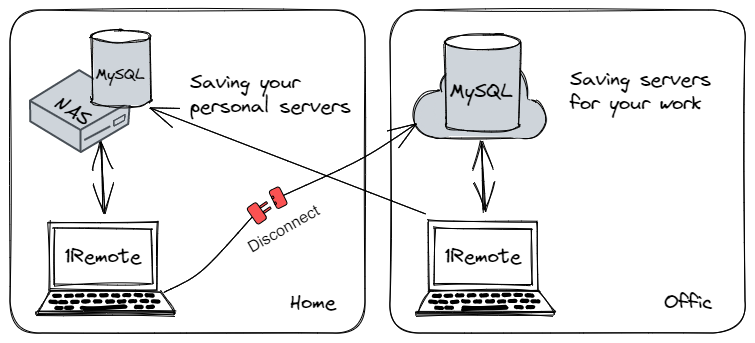
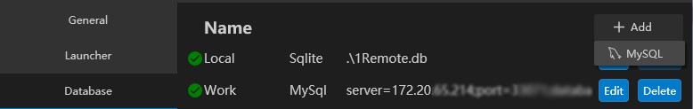
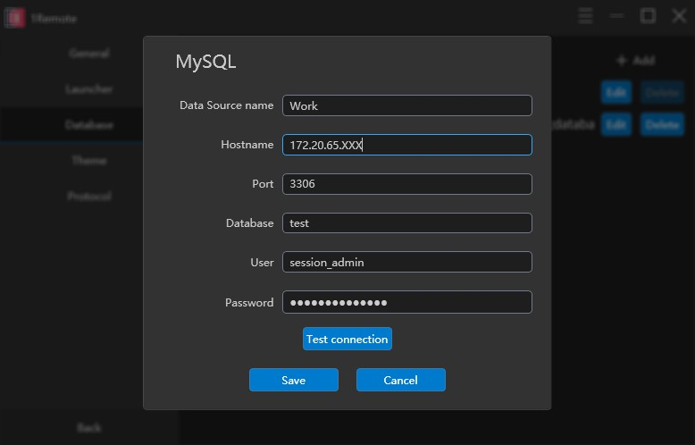
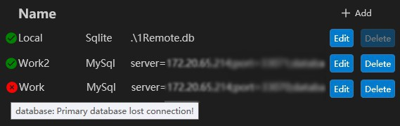
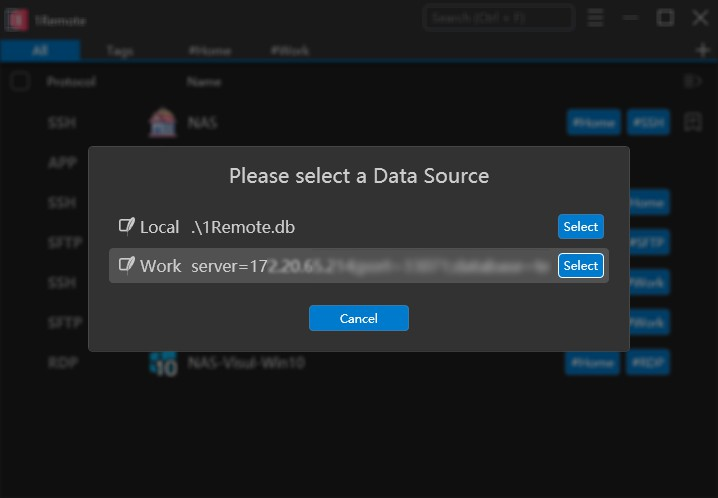
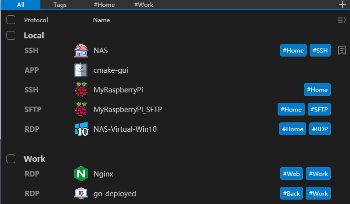

# Use online database

Besides the local SQLite database `Local`, {{appname}} can keep servers in a **MySQL** or a **PostgreSQL** database. You can connect to several databases at the same time, and every server belongs to one of them.

This is where more than one database becomes useful:

- **At home**: connect to the PostgreSQL database on your NAS to manage your personal servers.
- **At work**: connect to the database on your home NAS *and* to the MySQL database on the company server, so you can reach your private servers and the servers for work in one list.
- **For a team**: all colleagues connect to the same database. Those with a read-only account can see and connect to the servers but can not change them, see [Team sharing](/usage/team/team-sharing/).

## Add a database

1. Click **`Options`** in the main window and open the **`Database`** page.
2. Click **`Add`** and choose **`MySQL`** or **`PostgreSQL`**.

    

3. Fill in the form and click **`Test connection`**: a message box tells you whether the account can reach the database.
4. Click **`Save`**.

| Field            | What to enter                                                                                                    |
| ---------------- | ---------------------------------------------------------------------------------------------------------------- |
| Data Source name | The name {{appname}} shows for this database, for example `Home NAS`. Any name is fine.                          |
| Hostname         | The address of the database server, for example `192.168.1.10` or `nas.local`.                                  |
| Port             | `3306` for MySQL, `5432` for PostgreSQL. Both are filled in for you.                                            |
| Database         | The name of an existing database on the server, `1Remote` is filled in as a suggestion. {{appname}} creates its tables in it on the first connection; the database itself has to exist. |
| User, Password   | An account of the database server. See [Permissions](#permissions) for what the account must be allowed to do.    |

{{appname}} creates three tables in the database by itself: `Configs`, `Servers` and `Credentials` (the [Credentials Vault](/usage/database/security/#credentials-vault)). You only have to create the database; the tables are made during the first connection with a read-and-write account.

## The database list

After **`Save`** the database shows up in the list on the **`Database`** page, with an icon that shows its state:

| Icon                 | Meaning                                                                                                                       |
| -------------------- | ----------------------------------------------------------------------------------------------------------------------------- |
| red icon             | {{appname}} can not connect, for example a wrong password or the server is unreachable. Move the mouse over the icon to see the reason, click it to try again. |
| green icon           | Connected, and the account may read and write.                                                                                |
| green icon with lock | Connected, but the account may only read. The name gets the addition ` (Readonly)`, see [Permissions](#permissions).      |

!!! note
    The screenshots on this page are from an older version of {{appname}}; the names of the fields and buttons are still the same.

## Choose the database of a new server

When more than one database is connected, {{appname}} asks **`Please select a Data Source`** when you add a server. Read-only databases are in the list too, but their **`Select`** button stays disabled: a new server needs a database you may write to.

In the `List` view the servers are grouped by database, so you can see at a glance where a server is stored:

## Changes show up within about 10 seconds

Every 10 seconds {{appname}} asks each connected database whether something changed, and reloads the servers of that database if so. When a colleague adds a server, it shows up on your screen within about 10 seconds without doing anything. The same check is used for the local SQLite file, see [Data synchronization](/usage/database/data-synchronization/).

## Permissions

What an account can do inside {{appname}} follows what the account may do in the database:

- **Read and write account**: can do everything. The *first* connection to a new database must be made with such an account, because {{appname}} creates its tables then. The account needs `Create`, `Select`, `Insert`, `Update` and `Delete` on the database.
- **Read-only account** (`Select` only): inside {{appname}} it can see the servers and connect to them, nothing more. For servers in such a database the menu of a server offers no **`Edit`**, **`Duplicate`**, **`Delete`**, **`Copy username to clipboard`** or **`Copy password to clipboard`**, the **`Edit`** and **`Delete`** buttons at the bottom of the main window stay disabled, and the database carries the addition ` (Readonly)` in the database list.

{{appname}} finds out which kind of account it is on every connection: it tries to delete, insert and update a test entry (`permission_check`) in the `Configs` table. If one of these fails, the database is treated as read-only.

!!! warning
    Read-only is not a password protection. A read-only account can still read the whole `Servers` table, and the passwords in it are only obfuscated, not encrypted (see [Security](/usage/database/security/)). Hand out the read-only account only to people who may see those passwords.

    {{appname}} does not lock the data while you edit it: if two people change the same server at the same time, the last one to save wins. Keep the number of read-and-write accounts small.


