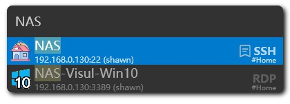
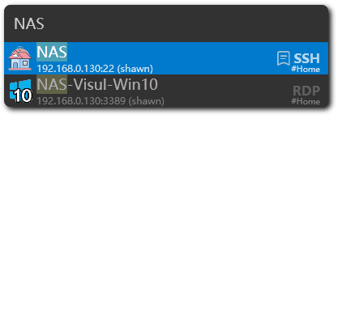
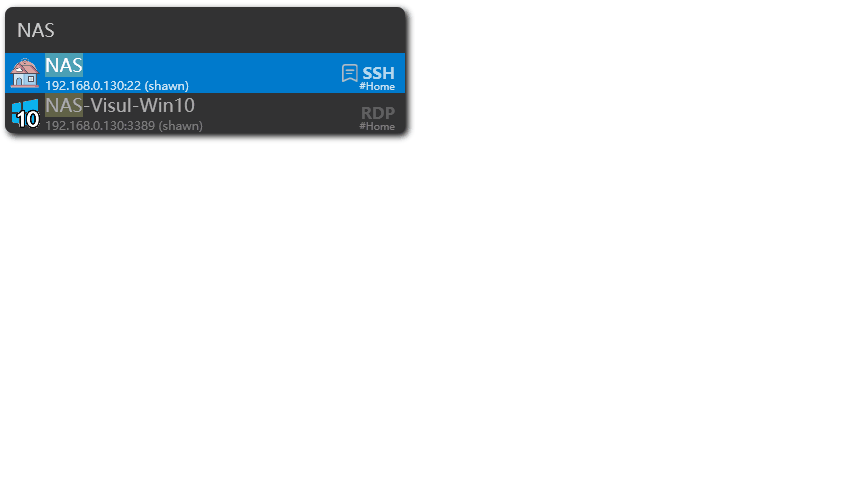

# Launcher

The launcher is a small window in which you start a remote session with a few keystrokes. Open it with the default shortcut ++alt++ + ++m++.

!!! note
    Launcher will be shown on the screen where your mouse is.

## Select

In the launcher, the servers are ordered by recent use. Use the ++up++ and ++down++ arrow keys to select the desired server, or type some keywords to search for it.

Press ++enter++ or double-click a server to start the remote session.

The keyword is matched against the server name and, when **`Show credentials info`** is on (see below), also against its address line (`address:port`). Type `#tag` to list only the servers with that tag, and `-#tag` to leave them out.

Several matching methods are switched on in **Options -> Launcher -> Keyword-Matchers**, for example *Direct match* (the keyword appears as typed), *Discrete match* (the keyword letters appear in this order with gaps), *Initials match* (`db1` finds `data-base-server-1`) and Chinese PinYin. An exact name match is listed first.

## Action list

When you select a server, press the ++right++ arrow key to open its action list: connect, connect with another credential, edit, copy the address and so on. Press ++left++ to close the list.

## Show note

In the server list, press ++left++ to show or hide the note of the selected server.

Or simply click the note icon.

## Settings

**Options -> Launcher** has the settings of the launcher:

- **`Enable the launcher`** and **`Hot key`**: turn the launcher off or change the ++alt++ + ++m++ shortcut.
- **`Keyword-Matchers`**: the matching methods described above.
- **`Show credentials info`**: show the address line (`address:port`) under each server in the list, and search it too.
- **`Quick Connect`**: see [Quick connect](quick-connect.md).


