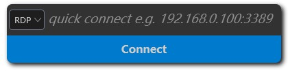
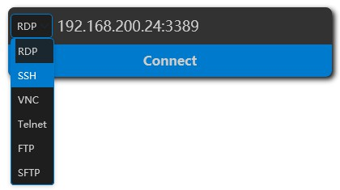
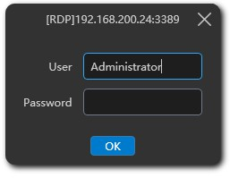
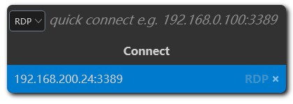

# Quick connect

In the launcher you can connect to a server without creating a server entry for it.

After the launcher shows up, press the ++tab++ key to switch to the quick connect mode.

In this view you can select the protocol and type the address and the port, then start the remote session.

Once you press ++enter++ key, a password window shows up. Fill in the user name and the password (or pick a private key for SSH and SFTP) to continue.

## History

1Remote remembers the addresses you connected to. They are listed below the input box; click one to fill it in, or click the `x` at its right end to remove it from the list.

- What is remembered is controlled by **Options -> Launcher -> `Allow Quick Connect to save entered address information`**. It is on by default. When you turn it off, the history is deleted.
- The list keeps the newest 50 addresses. It is stored on this PC only, in the file `.connection_records.json` of the `.locality` folder (see [Where your data is](/usage/database/data-synchronization/#where-your-data-is)).
- The password is **not** saved unless you tick **`Remember the information above`** in the password window. Tick it and the user name and password are stored together with the address, with the same obfuscation that the database uses for passwords (see [Security](/usage/database/security/)). Leave it unticked and you type the password every time.

!!! warning
    A remembered password can be read by anyone who can read the files of your Windows account. Lock Windows when you leave your computer.


