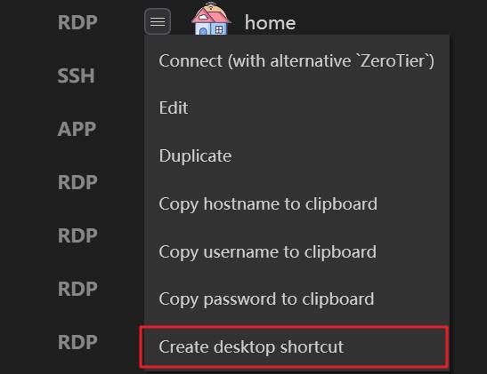
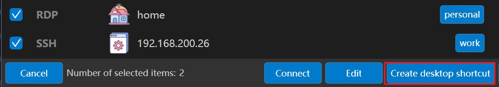
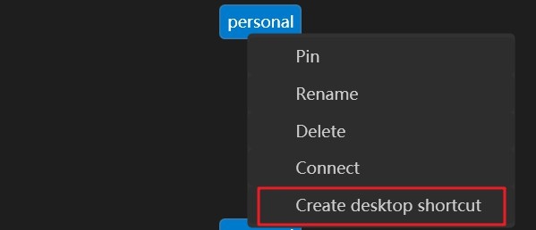
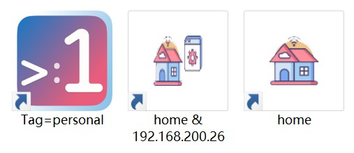

# Desktop shortcut for connections

A shortcut on your desktop can start one server, several servers at once, or all servers of a tag with a double-click. {{appname}} creates these shortcuts for you; they use the [command line](cli.md) arguments, so you do not have to type anything.

## One server

Right-click the server, or click the **`Settings`** button that appears when you move the mouse over it, and choose **`Create desktop shortcut`**.

## Several servers at once

1. Tick the check boxes of the servers, or hold ++ctrl++ / ++shift++ and click them.
2. Click **`Create desktop shortcut`** at the bottom of the main window.

The shortcut starts all of them. Its name is the names of the servers joined with ` & `.

## All servers of a tag

Right-click a tag in the tag bar above the server list and choose **`Create desktop shortcut`**.

The shortcut is named `Tag=<tag>`. It always starts the servers that *have the tag when you double-click it*, so servers you tag later are started too.

## What such a shortcut does

- Double-click it and {{appname}} starts (when it is not running yet) and connects to the servers. The main window stays closed; the sessions open in a session window.
- It refers to the servers by their internal id, not by name, so it keeps working when you rename a server. If the server was deleted, or you copy the shortcut to a PC whose {{appname}} does not know that server, nothing happens.
- It contains no password. It only works together with your {{appname}} data, so you do not hand out credentials when you pass it on.
- Its icon is the icon of the server. For several servers the icons are combined into one.

## Shortcut demonstration


