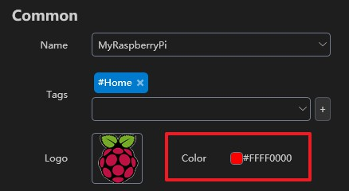
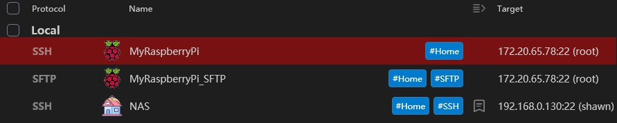
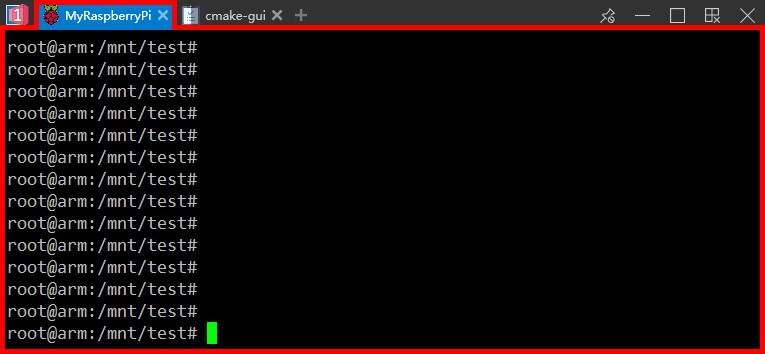

# Highlight a server

Every server entry has a **color**. The color tints the entry in the server list and the launcher, and draws the border of its tab, so the servers you care about stand out at a glance: the production machine among the test machines, or the NAS (network-attached storage) among the rest.

## Set the color

1. Open the server with **`Edit`**.
2. In the **`Common`** section, next to **`Logo`**, click the colored square after **`Color`** and pick a color.
3. Click **`Save`**.

## Where the color shows

- **Server list**: the whole line (or card) of the server is tinted with the color, in every view of the list.
- **Launcher**: the line of the server in the result list is tinted the same way.
- **Tabs**: the header of the session's tab gets a colored border, and the tab window is framed with the color of the open tab. That way you see which machine you are on before you type.

To remove the color, open the picker again and click the swatch with the chessboard pattern at the end of the palette; it stands for *no color*.


