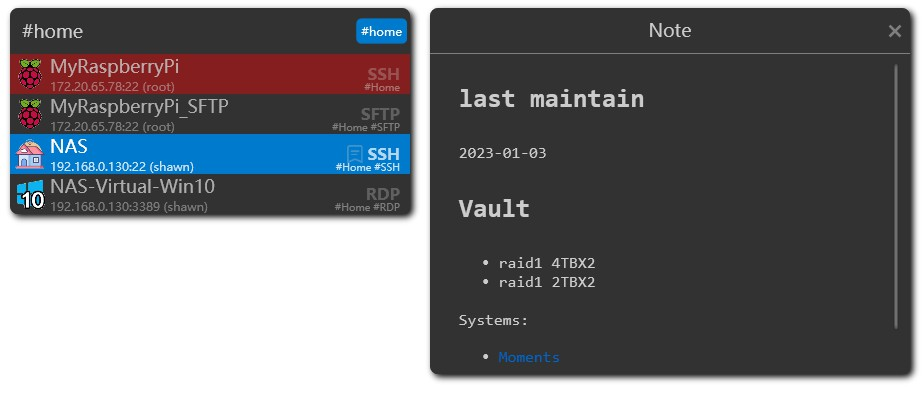
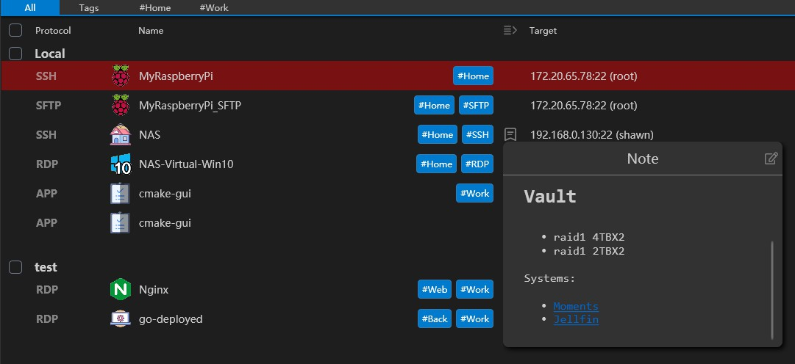
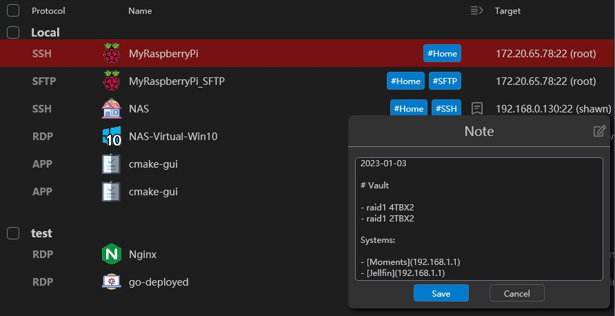

# Note for a server

Every server entry has a **note** in [Markdown](https://commonmark.org/help/): headings, lists, links, images, tables and code, rendered as formatted text. The note shows up next to the server in the list and in the launcher, so things like the date of the last maintenance or the disk layout of a NAS are at hand when you connect.

## Write the note

1. Open the server with **`Edit`**.
2. The **`Note`** box is on the right side of the editor. Type Markdown into it; the grey text shows an example with a heading, a list, an image and a link.
3. Hover the small note icon above the box to see the rendered note.
4. Click **`Save`**.

```
## Vault

2023-01-03

- raid1 4TBX2
- raid1 2TBX2

Systems:

- [Moments](http://192.168.1.1)
- [Jellyfin](http://192.168.1.1)
```

## Read the note

- **Server list**: servers with a note show a note icon in front of the address. Hover it to read the note in a popup. To see the notes of all rows at once, click the note button at the right end of the list header: it opens the **`Note`** column, and the button in that column's header closes it again. {{appname}} remembers the state.
- **Launcher**: the **`Note`** panel on the right shows the note of the selected server. Press ++left++ to hide it and again to show it; the note icon next to a server does the same.



Links in a note open in your browser; clicking an image opens its address the same way.

## Change the note without opening the editor

Click the pencil icon in the top-right corner of a note popup or panel. The text becomes editable; **`Save`** keeps the change on the server entry, **`Cancel`** drops it. For a server in a read-only database the text is shown for copying only.






