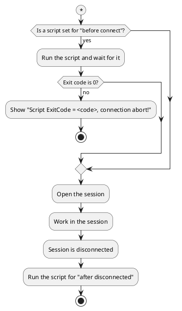
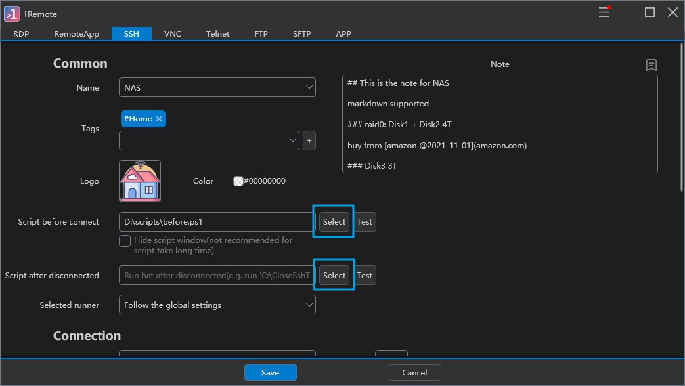
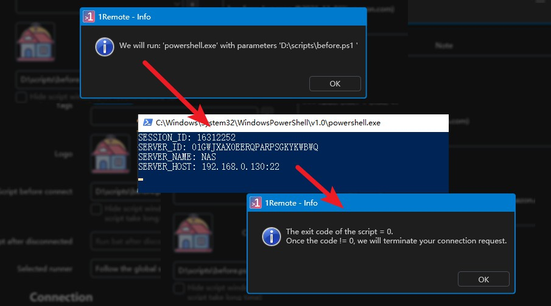

# Scripts before connect and after disconnect

For every server you can set two scripts: one that runs **before** {{appname}} connects, and one that runs after the session was **disconnected**. A script is a `.bat` or `.cmd` file, a `.ps1` PowerShell script or a `.py` Python script. The usual case is to open a VPN before the connection and to close it after the session, see [Open a VPN before connect](open-a-vpn-before-connect.md).



## Set up the scripts

1. Open the server in the editor (**`Edit`**).
2. In **`Script before connect`** type the path of the script, or click **`Select`** to pick the file. Arguments may follow the path, for example `D:\scripts\before.ps1 -Vpn home`.
3. Click **`Test`**: {{appname}} tells you what it is going to run, runs the script and shows its exit code.

    

    

4. Do the same for **`Script after disconnected`**.
5. Click **`Save`**. From now on the scripts run every time you connect to this server.

## How the scripts are run

- The working directory of a script is the folder the script file is in.
- A `.ps1` file is started with `powershell.exe -File`, a `.py` file with `python` (so Python has to be in the `PATH`), a `.bat` or `.cmd` file directly.
- **`Script before connect`**: {{appname}} waits until the script has ended. Exit code `0` means "go on and connect"; any other code stops with the message `Script ExitCode = <code>, connection abort!`. Tick **`Hide script window(not recommended for script take long time)`** to run the script without a window; the tooltip warns you because you would not see a script that hangs. The **`Test`** run always shows the window.
- **`Script after disconnected`**: runs when the session ends, that is when you close its tab (or, for a program that runs unhosted in its own window, when that program has exited). {{appname}} does not wait for it and ignores its exit code. Its window is hidden; only the **`Test`** run shows it.

!!! tip
    If Windows refuses to run your `.ps1` file with a message about the *execution policy*, run this once in a PowerShell window:

    ```powershell
    Set-ExecutionPolicy -Scope CurrentUser RemoteSigned
    ```

## Environment variables

Every script gets these variables, so it knows which server and which session it is about:

| Variable      | Content                                                                     | Example                       |
| ------------- | --------------------------------------------------------------------------- | ----------------------------- |
| `SESSION_ID`  | A number that identifies the session. It is the same in the before and the after script of one session, and different in the next session. | `16312252`  |
| `SERVER_ID`   | The internal id of the server. It stays the same when the server is renamed. | `01GWJXAXUOBERQPARPSGKYKWBWQ` |
| `SERVER_NAME` | The name of the server as shown in the list.                                | `NAS`                         |
| `SERVER_HOST` | Address and port of the server, separated by a colon.                       | `192.168.0.130:22`            |
| `SERVER_TAGS` | The tags of the server, separated by commas.                                | `home,nas`                    |

In PowerShell you read them as `$env:SERVER_NAME`, in a batch file as `%SERVER_NAME%`.

## Example script

The following PowerShell script shows all variables, writes them to a file and ends with exit code `0`, so the connection goes on:

```powershell
$sessionID  = $env:SESSION_ID
$serverID   = $env:SERVER_ID
$serverName = $env:SERVER_NAME
$serverHost = $env:SERVER_HOST
$serverTags = $env:SERVER_TAGS

Write-Host "SESSION_ID: $sessionID"
Write-Host "SERVER_ID: $serverID"
Write-Host "SERVER_NAME: $serverName"
Write-Host "SERVER_HOST: $serverHost"
Write-Host "SERVER_TAGS: $serverTags"

Set-Content -Path "temp.txt" -Value "SESSION_ID: $sessionID`r`nSERVER_ID: $serverID`r`nSERVER_NAME: $serverName`r`nSERVER_HOST: $serverHost`r`nSERVER_TAGS: $serverTags"

# Things you may want to do:
# if ($serverTags -like '*HOME*') { <# open VPN 1 #> }
# if ($serverTags -like '*WORK*') { <# open VPN 2 #> }

# do something that takes time, like opening a VPN
Start-Sleep -Seconds 3

# a non-zero exit code stops the connection
exit 0
```

[Open a VPN before connect](open-a-vpn-before-connect.md){ .md-button }


