# Overview

## Managing Servers

### Adding Server

1. Click the **`+`** button in the upper-right corner of the main window.

    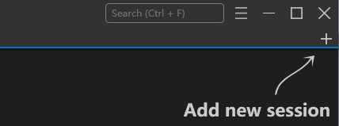

2. Choose a protocol, such as RDP, SSH, or VNC, at the top of the pop-up window.

    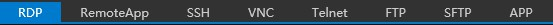

3. Set the server's name, tags, notes (supports Markdown), and others.
4. (Optional) Change the server icon (pick one or upload your own) and give the server a color, see [Highlight a server](/usage/misc/highlight-a-server/).

    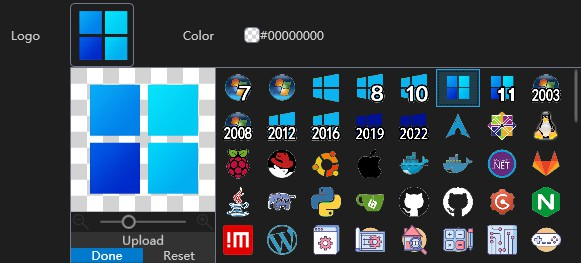

5. (Optional) Configure scripts for the server, such as opening VPN before starting remote desktop, or closing VPN after closing remote desktop. Scripts support cmd, PowerShell, and Python. Please see the [Open a VPN before connect](/usage/misc/pre-post-script-control/open-a-vpn-before-connect/) for further details.

6. Continue entering server **address**, **port**, **credentials** and other information, and select your desired connection settings.
7. Click the **`Save`** button to complete adding the server and return to the main window.

### View: cards, list or tree

Click the **☰** menu button in the upper-right corner of the main window and choose **`View`**. The servers of the main window are shown in one of three ways:

- **`Card`**: one card per server, with the icon, the name and the tags.
- **`List`**: one row per server. Drag the edge of a column header to change its width, and click a column header to sort by it.
- **`Tree`**: the servers in a tree of folders that you create yourself. Every database you connected (every *data source*, see [Use online database](/usage/database/use-online-database/)) is a root of the tree. Right-click a node and choose **`Create a folder`**, then drag servers into the folder. Right-click a folder to **`Rename`** or **`Delete`** it (the servers inside move up to the parent folder). Tags in the tag bar of this view can be **`Pin`**ned, so the bar keeps showing them when the list is filtered.

### Sorting

- In list mode, click on the header above the list to sort the servers.
- Or click the **☰** menu button in the upper-right corner of the interface and choose **`Sorting`**: **`Sort by drag`** (drag each server to its place), by protocol, by name or by host name. Host names are sorted naturally, so `192.168.1.9` comes before `192.168.1.10`.

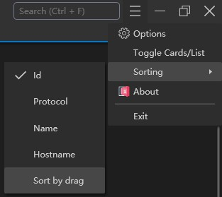

### Edit

When you move the mouse over a server, a **`Settings`** button appears. Click it for a menu where you can connect, edit, duplicate, delete the server, or copy its address, user name and password. (Note: If you connect to a database with a read-only account, you will not be able to edit, copy the credentials or delete server information stored in that database. Such databases carry the addition `(Readonly)` in the database list of **Options -> Database**, see [Online database](/usage/database/use-online-database/#permissions).)

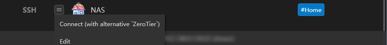

!!! tip
    You can also directly enter the edit interface by right-clicking on a server with your mouse.

### Select several servers

Tick the check box of a server to select it, or hold ++ctrl++ / ++shift++ and click servers as you do in Windows Explorer. With several servers selected, the buttons at the bottom of the main window act on all of them: **`Connect`**, **`Edit`**, **`Delete`**, **`Export`** and **`Create desktop shortcut`**.

### Bulk edit

Click the **`Edit`** button at the bottom of the main window with several servers selected to enter the batch editing interface, where you can change the address, the credentials, the tags and so on for all of them at once. With tags, you can select all servers with one tag and change their addresses or passwords in one go.

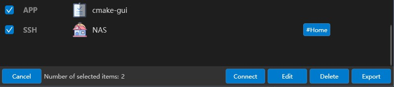

### Data export

!!! warning inline end
    The exported data is stored in plain text, so please handle it with care.

When some servers are selected, the **`Export`** button exports them to a json file which you can import on another PC or simply keep as a backup. The file name is the date and time of the export, for example `20261123103000.json`. If you turned on [secondary verification](/usage/database/security/#secondary-verification), you have to verify yourself before the export starts. Please see the [Data synchronization](/usage/database/data-synchronization/) for further details.

### Data import

Click the **`+`** button in the upper-right corner of the main window, then **`Import`**. You can import:

#### Importing from 1Remote

Choose **`import json`** and select a json file exported by 1Remote.

#### Importing from mRemoteNG

1. In mRemoteNG, right-click on the server and choose "**Export to File...**". Set the "**File Format**" to "**mRemoteNG CSV**" in the pop-up window, and click the **`OK`** button in the lower-right corner to export.
2. In 1Remote, choose "import mRemoteNG csv". Select the CSV file you just exported in the pop-up dialog, and click "Open" to complete the import.

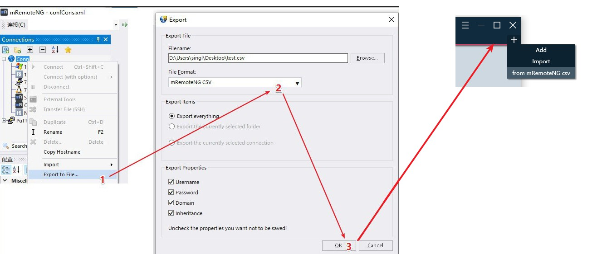

#### Importing from PRemoteM

Since PRemoteM is our old name, you can also import data from PRemoteM.

Our migration tool will auto detect your old data when you first start {{appname}}.

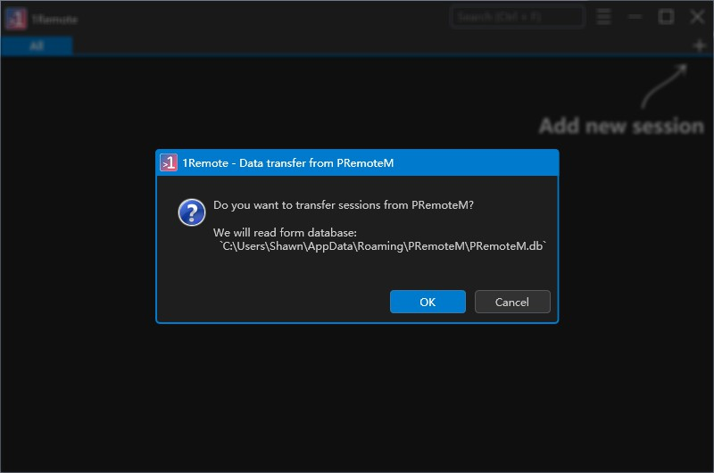

If you miss the auto-migration, choose **`import PRemoteM db`** and select the PRemoteM database file `PRemoteM.db`. It is in `%AppData%\PRemoteM\`, or next to `PRemoteM.exe` if you ran PRemoteM in portable mode. Turn off the RSA encryption of the database in PRemoteM first. Otherwise the names, addresses and passwords are imported unreadable, because {{appname}} can not decrypt such a database (support for it was removed in 1Remote 1.3.0).

#### Importing from RDP Files

!!! warning inline end
    An .rdp file does not contain the password. 1Remote reads the user name and password that mstsc saved in Windows Credential Manager for that address; if there is none, enter the password yourself after the import.

1. In `mstsc.exe`, click "Show Options" to expand the window, click the **`Save As...`** button under "Connection settings", and save as an RDP file.
2. In {{appname}}, click the **`+`** button in the upper-right corner of the main window, and choose "**import *.rdp**". Select the RDP file you just saved in the pop-up dialog, and click "Open" to complete the import.

## Starting Remote Connections

### Starting from the main window

1. Double-click a server to open the corresponding remote session.
2. Or tick the servers and click the **`Connect`** button at the bottom of the main window to start several sessions at once.
3. If you have tagged the servers, you can right-click the tag in the tag bar above the main window, and click the **`Connect`** button to start all servers of that tag at once.

### Starting from the Launcher

Press the default shortcut ++alt++ + ++m++ to show the launcher, type a few letters of the server you want, and press ++enter++ to start.

For more details about the Launcher, please see the [Launcher](/usage/launcher/basic/).

## Session view

Remote sessions open as tabs of a session window. Every tab has a header with the session name; right-click the header to **`Reconnect`** or **`Close`** the session, to edit or duplicate the server, to copy its address or credentials, or to open an SFTP session to the same server (SSH only).

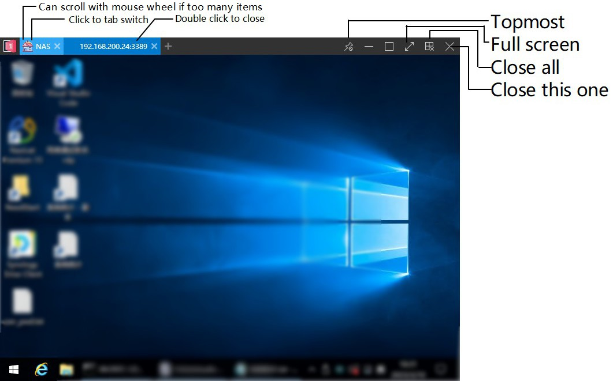

- **Move a session to its own window**: drag the tab out of the window. Drag it back into another session window to dock it there; an empty session window closes by itself.
- **Always open in a new window**: tick `Always open in new window` in the server editor to give this server its own window every time.
- **Keyboard**: ++ctrl+1++ to ++ctrl+9++ switch between the tabs, ++f11++ toggles a borderless full-screen window, a middle-click on a tab header closes it.
- **Reconnect**: when an RDP session loses its connection, 1Remote tries to reconnect up to 5 times and shows `Reconnecting...(n/5)` in the tab title. If it gives up, the window leaves full screen and offers a **`Reconnect`** and a **`Dismiss`** button.
- **Window buttons**: the title bar of a session window has a pin to keep it always on top, a full-screen button (for RDP and VNC), a red **`Close all`** button (when more than one tab is open), and the usual minimize, maximize and close buttons. In **Options -> General -> Tab** you can move the close button to the left side and choose which buttons the tab headers show.

## Tag management

Every server can have several tags. All tags are shown on the **`Tags`** page of the main window.

Tags you **pin** (right-click a tag, **`Pin`**) stay in the tag bar above the server list, so one click filters the list.

!!! tip
    Keep tag names short, they share the space in the tag bar.

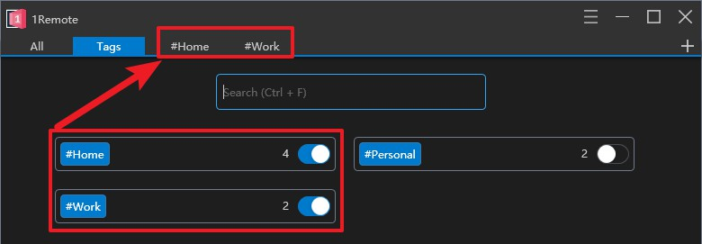

### Rename tag

Right-click on a tag to find the **`Rename`** button.

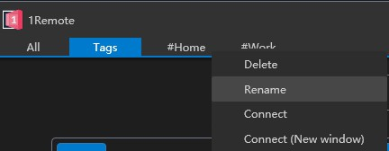

### Filter by several tags

Click a tag on a server line to show only the servers with that tag. Hold ++ctrl++ and click more tags to show servers with any of them; hold ++alt++ and click a tag to hide the servers with it. In the tag bar, a click sets the filter and ++ctrl++ + click adds a tag.

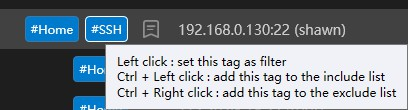

For example: show all servers tagged `home`, but leave out the ones tagged `RDP`.

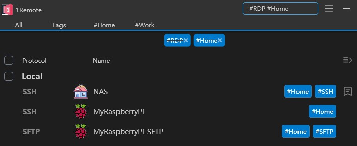


