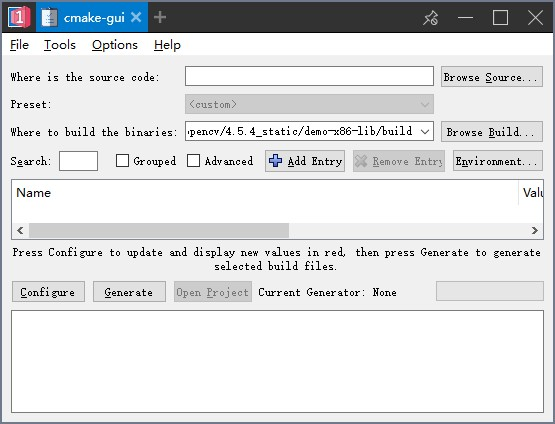

# APP: start any program

The **APP** protocol starts a program on your own PC with the arguments you choose, for example a browser with a URL, `cmake-gui` with a build folder or NoMachine with a session file. Such an entry shows up in the server list and the launcher like any other server, so you can start the program with a few keystrokes. Its arguments can use the address, the user name and the password of the entry, which makes the entry a launcher for programs that {{appname}} does not know.

## Add an APP entry

1. Click the **`+`** button in the upper-right corner of the main window and choose **`APP`**.
2. **`Exe path`**: type the path of the program or click **`Select`**. Environment variables are allowed, for example `%VNC%\viewer.exe`.
3. If the name of the exe is known to {{appname}}, it fills in the arguments, the hosting switch and the protocol name for you (see [Presets](#presets)). You get a question whether to replace the current parameter list when the entry already has arguments.
4. **`Hosting`**: tick it to show the program inside an {{appname}} tab. Some programs do not allow that, so untick it when the program does not start.
5. **`Protocol`** (optional): the name shown instead of `APP` in the server list, for example `NoMachine`.
6. Fill in the **`Cmd parameter`** list, see the next section.
7. Click **`Save`**.

## The parameter list

Instead of one long command line, the arguments of an APP entry are a list. Each line of the list is one argument with a **`Name`**, a **`Prefix`** (the switch in front of the value, may be empty), a **`Value`** and a **`Preview`** of what ends up on the command line. Use **`Edit`** to open the editor, **`+`** to add an argument, and the buttons next to an argument to move it up or down, change it or delete it. The **`Preview`** line under the list shows the complete command line; **`Test`** starts the program with it right away.

The editor of one argument has these fields:

| Field                            | Meaning                                                                                                                                      |
| -------------------------------- | -------------------------------------------------------------------------------------------------------------------------------------------- |
| **`Type`**                       | `Normal`: text. `Int`/`Float`: a number, checked when you save. `File`: a path, with a **`Select`** button, must exist. `Secret`: a password, stored obfuscated like other passwords and shown as `******`. `Flag`: the prefix alone, when the value is `1`. `Selection`: one of the lines in **`Selections`**. `Const`: fixed text, usually a macro like `%1RM_HOSTNAME%`; in the list it is plain text that you change with the **`Edit`** button. |
| **`Name`**                       | A name for the argument, shown in the list. Must be unique in the entry.                                                                       |
| **`Prefix`**                     | The text in front of the value, for example `-P`. Untick **`append blank after prefix`** when the value must follow directly, as in `-P22` or `sftp://`. |
| **`Value`**                      | The value. Macros and environment variables are allowed.                                                                                       |
| **`append blank after value`**  | Add a space behind the value. Untick it when the next argument must follow directly, as in `user:password@host`.                               |
| **`Nullable`**                  | The argument may be empty; an empty argument is left out of the command line.                                                                   |
| **`Description`**                | Shown as a hint in the list.                                                                                                                   |
| **`Selections`**                | Only for `Selection`: one option per line, `value` or `value` + `|` + `description`, for example `sftp` and `ftp|FTP protocol`.              |

The connection fields **`Hostname`**, **`Port`**, **`User`**, **`Password`** and **`Private key`** appear in the entry as soon as an argument uses the matching macro: `%1RM_HOSTNAME%`, `%1RM_PORT%`, `%1RM_USERNAME%`, `%1RM_PASSWORD%`, `%1RM_PRIVATE_KEY_PATH%`. So one APP entry can stand for a whole class of programs, and you fill in the connection details like for any other server.

## Presets

When you pick an exe with one of these names, {{appname}} fills in the parameter list, the protocol name and the hosting switch. This list is for APP entries only; external runners have their own, shorter list, see [Runner](../runner.md).

| Exe name                                   | Protocol name shown | Arguments filled in                                                                                                         |
| ------------------------------------------ | ------------------- | ---------------------------------------------------------------------------------------------------------------------------- |
| `chrome.exe`, `msedge*`                    | Chrome              | one argument **`Url`** (not empty)                                                                                             |
| `nxplayer.exe`                             | NoMachine           | one argument **`nxs file`**, a file that must exist                                                                             |
| `freerdp.exe`                              | FreeRdp             | `/t:`, `/v:%1RM_HOSTNAME%`, `/port:%1RM_PORT%`, `/d:`, `/u:%1RM_USERNAME%`, `/p:%1RM_PASSWORD%`, the flags `/admin`, `/f`, `/multimon`, `+clipboard`, `/w:`, `/h:` |
| `putty*.exe`, `kitty*.exe`                 | PuTTY               | `-ssh %1RM_HOSTNAME% -P %1RM_PORT% -l %1RM_USERNAME% -pw %1RM_PASSWORD%`, SSH version `V1`/`V2`; KiTTY also gets `-cmd` for an auto command. Hosted in a tab. |
| `wt.exe`                                   | WT                  | Windows Terminal with `plink`: `-w 1 new-tab --title "%1RM_HOSTNAME%" --suppressApplicationTitle plink -ssh %1RM_HOSTNAME% -P %1RM_PORT% -C -X -no-antispoof -l %1RM_USERNAME% -pw %1RM_PASSWORD%` |
| `WinSCP.exe`                               | WinSCP              | `sftp` or `ftp` + `://%1RM_USERNAME%:%1RM_PASSWORD%@%1RM_HOSTNAME%:%1RM_PORT%`, optional `/privatekey=%1RM_PRIVATE_KEY_PATH%`   |
| `filezilla.exe`                            | (none)              | `sftp` or `ftp` + `://%1RM_USERNAME%:%1RM_PASSWORD%@%1RM_HOSTNAME%:%1RM_PORT%`                                                 |
| `tvnviewer.exe`, `*TightVNC*`              | VNC                 | `%1RM_HOSTNAME%::%1RM_PORT% -password=%1RM_PASSWORD% -scale=auto`. Hosted in a tab.                                            |
| `vncviewer.exe`, `*uvnc*`                  | VNC                 | `%1RM_HOSTNAME%:%1RM_PORT% -password %1RM_PASSWORD%`                                                                          |

Change whatever does not fit; the preset is only a starting point.

The `*` in the table stands for any text, and the name is looked up in the whole **`Exe path`**: `putty*.exe` matches any exe whose path contains `putty`, and `*TightVNC*` matches any path that contains `TightVNC`.

## Examples

### Open a web site with Chrome or Edge

Pick `chrome.exe` or `msedge.exe`, type the URL into **`Url`** and save. Double-click the entry and the browser opens the page.

### Open a NoMachine session

Recent versions of NoMachine accept a session file on the command line, but no longer a password. With an APP entry you start such a session with a double-click:

1. In NoMachine, right-click the connection and export it as an `.nxs` file.
2. In {{appname}}, add an APP entry, pick `nxplayer.exe` as **`Exe path`** and select the `.nxs` file as **`nxs file`**.
3. **`Save`**. Double-click the entry to start the session.

!!! tip
    The same works for every program that takes its connection on the command line, and for plain programs you start often, such as Word or Notepad.


