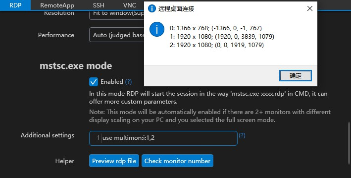

# RDP in mstsc.exe mode

Normally {{appname}} shows an RDP session inside its own window, using the Remote Desktop ActiveX control of Windows. In **mstsc.exe mode** it writes a temporary `.rdp` file instead and starts the session with `mstsc.exe <file>.rdp`. `mstsc.exe` is the Remote Desktop Connection program of Windows, so the session then opens in a window of its own, and you can put any setting into the `.rdp` file that `mstsc.exe` understands.

## When to use it

- Your PC has two or more monitors with **different scale factors** (for example 100 % and 150 %), and you want the session on **all screens**. The ActiveX control can not handle mixed scale factors; `mstsc.exe` can. {{appname}} switches to mstsc.exe mode by itself in this case, you do not have to do anything.
- You need a setting that the ActiveX control does not offer, for example the choice of the monitors (`selectedmonitors`), or the resolution of the session (`desktopwidth`, `desktopheight`).

## Turn it on

Open the RDP server with **`Edit`** and tick **`Enabled`** under **`mstsc.exe mode`**. The session then always starts with `mstsc.exe`, whatever your monitors are.

## Additional settings

The text box **`Additional settings`** holds the lines to add to the `.rdp` file, one setting per line in the usual `.rdp` form `name:type:value`. Leave it empty to get the same session as the built-in runner.

| Setting                    | Effect                                                                                                                                                                                          |
| -------------------------- | ----------------------------------------------------------------------------------------------------------------------------------------------------------------------------------------------- |
| `selectedmonitors:s:0,2`   | Use only the monitors number 0 and 2 for the remote desktop; monitor number 1 keeps showing your local desktop. Click **`Check monitor number`** to see which number each monitor has (it runs `mstsc /l`). |
| `redirectcomports:i:1`     | Redirect the COM ports of your PC to the session.                                                                                                                                               |
| `desktopwidth:i:800`       | Width of the remote session in pixels.                                                                                                                                                          |
| `desktopheight:i:600`      | Height of the remote session in pixels.                                                                                                                                                         |

Example: three monitors, the session shall cover number 1 and 2, and number 0 shall stay local:

Click **`Preview rdp file`** to see the complete file {{appname}} is going to write, with your lines at the end. The temporary file is deleted about 30 seconds after the session started.

More settings:

- [Remote Desktop Protocol files](https://learn.microsoft.com/en-us/windows-server/remote/remote-desktop-services/clients/rdp-files) in the Microsoft documentation
- [RDP settings for older Windows versions](https://learn.microsoft.com/en-us/troubleshoot/windows-server/remote/remote-desktop-protocol-settings)


