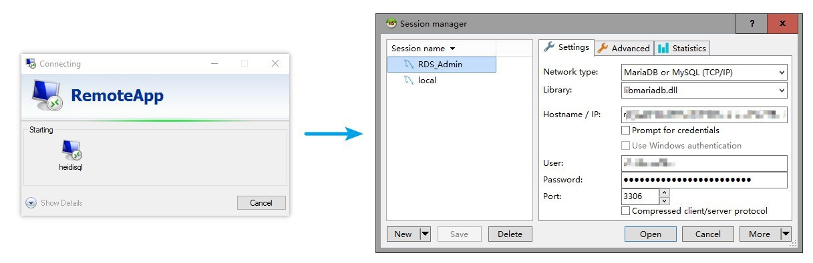
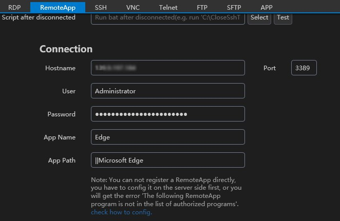
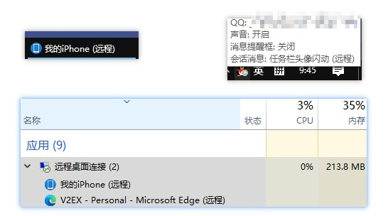

# RemoteApp

A **RemoteApp** is a single program that runs on a Windows server with Remote Desktop Services, while its window appears on your own desktop as if the program were installed locally. You do not see the desktop of the server, only the program. Windows calls this *RemoteApp*; the session uses the Remote Desktop Protocol (RDP).

Two steps are needed: the program has to be published as a RemoteApp on the server, and {{appname}} needs an entry that starts it.

## Step 1: publish the program on the server

Pick the way that fits your server:

**With Server Manager** (a Windows Server with Remote Desktop Services):

1. Open **Server Manager**, choose **Remote Desktop Services** -> **Collections** and open the collection.
2. Click **RemoteApp Programs** -> **Tasks** -> **Publish RemoteApp Programs**.
3. Click **Add**, pick the **EXE** of the program on the server, click **Next**, then **Publish**.

**With RemoteApp Tool** (also works on a PC that is not a Windows Server, but not on Home editions of Windows):

1. Install [RemoteApp Tool](https://github.com/kimmknight/remoteapptool) on the server or PC.
2. Create a RemoteApp with it, following [its guide](https://github.com/kimmknight/remoteapptool/wiki). It also sets the server so that programs outside the official list are allowed.

!!! warning
    Without one of these steps the connection fails with `The following RemoteApp program is not in the list of authorized programs`. On a PC that is not a Windows Server, the RemoteApp Tool is the way to go.

## Step 2: add the RemoteApp in {{appname}}

1. Click the **`+`** button in the upper-right corner of the main window and choose **`RemoteApp`**.
2. Fill in **`Hostname`**, **`Port`** (3389), **`User`** and **`Password`** of an account on the server.
3. **`App Name`**: a name for the program, for example `Edge`.
4. **`App Path`**: the full path of the exe on the server, for example `C:\Program Files (x86)\Microsoft\Edge\Application\msedge.exe`. This must be the path the server has published.
5. Click **`Save`** and connect. The program window opens on your desktop.

Here Edge and QQ (a Chinese chat program) run as RemoteApps on one desktop:

## Options of the entry

| Field                                              | Meaning                                                                                                   |
| -------------------------------------------------- | --------------------------------------------------------------------------------------------------------- |
| **`Ask for password when open connect`**           | Ask for the password on every connection instead of using the saved one.                                  |
| **`Sounds`** / **`Sound Quality`**                 | Where the sound of the program plays (local, on the server, off) and its quality.                         |
| **`Additional settings`**                          | Lines to add to the `.rdp` file {{appname}} writes for the session, see [RDP in mstsc.exe mode](rdp-in-mstsc-mode.md). |
| **`Preview rdp file`**                             | Shows the complete `.rdp` file.                                                                           |

{{appname}} starts a RemoteApp with `mstsc.exe` and a temporary `.rdp` file; the session opens in a window of its own, not inside the {{appname}} window.


