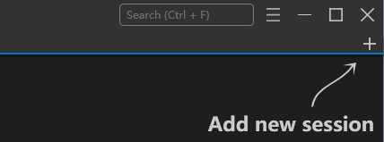
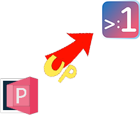
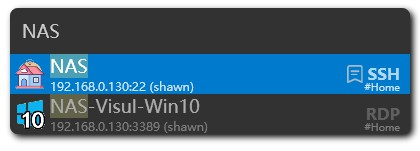

# {{appname}} Quick Start

{{appname}} is open source and free to use.

## Installation

[Download](../download.md){ .md-button }

## Adding Servers

### Manually Adding a Server

1. Click the **`+`** button in the upper-right corner of the main window.

    

2. Choose a protocol, such as RDP, SSH, or VNC, at the top of the pop-up window.
    

3. Set the server's name, tags, notes (supports Markdown), and other information and save.

[Learn more](/usage/overview/#adding-server){ .md-button }

#### Migrate from PRemoteM

!!! info "PRemoteM vs {{appname}}"
    {{appname}} is the upgraded version of PRemoteM.

Since PRemoteM is our old name, our migration tool will auto detect your old data when you first start {{appname}}.

<image src="/usage/img/migrate-tools-for-prm.jpg" width="400px"></image>

If you miss the auto-migration, you can still import it manually:

1. Find the PRemoteM database file `PRemoteM.db`. It is in `%AppData%\PRemoteM\`, or next to `PRemoteM.exe` if you ran PRemoteM in portable mode.
2. In {{appname}} click the **`+`** button in the upper-right corner, then click **`Import`** and choose **`import PRemoteM db`**. Select the `PRemoteM.db` file and click "Open".

!!! warning
    If you had turned on PRemoteM's RSA database encryption, 1Remote can no longer decrypt that database (support for it was removed in 1Remote 1.3.0). Disable the encryption in PRemoteM before you import the database, otherwise the names, addresses and passwords are imported encrypted and unreadable.

## Starting Remote Connections

### Starting from the main window

Simply double-click a server to open the corresponding remote session.

### Starting from the Launcher

Press the default shortcut ++alt++ + ++m++ to show the launcher, then:

- type a keyword to select the server you want, then press ++enter++ to start.
- ++right++ to open the action list of the selected server.
- ++tab++ to show the [Quick Connect view](/usage/launcher/quick-connect/).

[Learn more](/usage/launcher/basic/){ .md-button }

## Customization

All settings are in one window called **Options**. Click the **☰** menu button in the upper-right corner of the main window and choose **Options**.

- Change language: **Options** -> **General** -> **Language**
- Change theme: **Options** -> **Theme** -> **Theme**. On this page, you can also customize your favorite color scheme.
- Change the font or the color scheme of SSH sessions: **Options** -> **Protocol** -> **SSH**, on the **`Built-in PuTTY`** card

[Learn more from the **Overview**](./overview.md){ .md-button }


