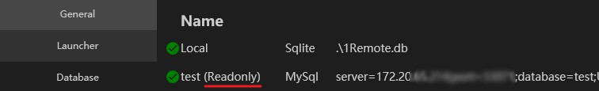

!!! warning
    Before you deploy this app to your team, set up a MySQL or PostgreSQL database for the team and create the accounts as described in [Team sharing](team-sharing.md).

Assuming you are the administrator and you have already imported the servers into the database with a read-and-write account, you can deploy the app to your team like this:

1. Connect to the database with the read-only account in your own {{appname}}, and check that the database carries the addition `(Readonly)` in the list of **Options -> Database**:

    

2. Tell every team member to install {{appname}} (see [Download](/download/)) and to add the database by hand: **Options -> Database -> Add -> MySQL** or **PostgreSQL**, with the host, the database name and the read-only account. **`Test connection`** tells them whether it works, see [Use online database](/usage/database/use-online-database/).

3. Nothing else is needed: as soon as the database is added, the team servers show up in the main window, and changes you make show up on their screens within about 10 seconds.

!!! note
    You can also hand out the file `1Remote.dataSources.json` instead of step 2. It is in the program folder (portable mode) or in `%AppData%\1Remote\` (AppData mode), see [Where your data is](/usage/database/data-synchronization/#where-your-data-is). The team member copies it next to their own `1Remote.db` while {{appname}} is closed.

    Think twice before you do: the file contains the password of the read-only account (only obfuscated, see [Security](/usage/database/security/)), and it replaces the data sources the team member had set up before.


