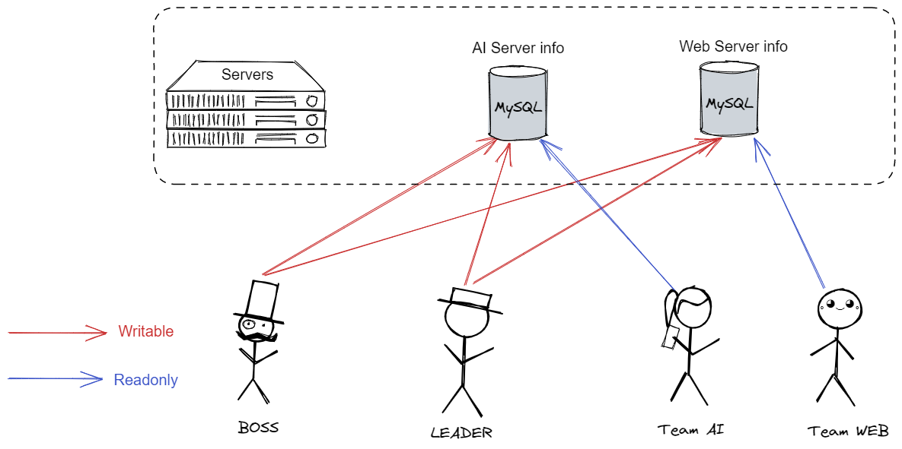
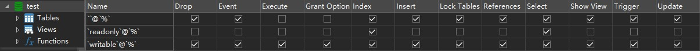
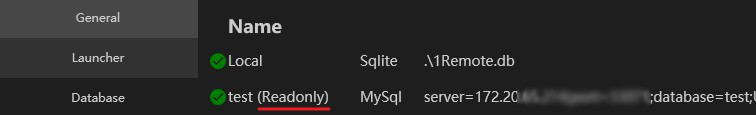
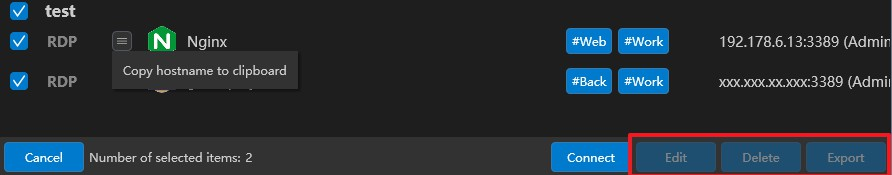

## Why

Suppose you are the team leader and your company has several servers to manage: the AI servers are for the AI team, the web servers are for the web team.

A typical use case is:

- Only you and your boss may add and modify servers. The other colleagues can only see the servers in the list; they can not edit them or see the password.
- The AI team works with the AI servers, the web team with the web servers.

1Remote can help you manage these servers with the `Team sharing` feature: the team connects to the same database with two kinds of account.

| Account                                                 | Connect | View address | Edit | Delete | View password |
| ------------------------------------------------------- | ------- | ------------ | ---- | ------ | ------------- |
| Read-only account (`Select` only)                       | ✅       | ✅            | ❌    | ❌      | ❌             |
| Read-and-write account                                  | ✅       | ✅            | ✅    | ✅      | ✅             |

Your team members connect to the same database with a read-only account: they can only see the servers and connect to them.

You connect with the read-and-write account and can add, edit and delete servers.

!!! note
    The Team sharing feature offers only very basic access control, and is not designed to give each team member an individual set of servers. "View password" means inside {{appname}} only, see the warning below. To keep the servers of two teams apart, use two databases.

## How

1. Create two accounts in MySQL or PostgreSQL with different permissions:

    

    In database `test`, account `writable` may select, insert, update and delete data, while account `readonly` may only select data. {{appname}} treats an account as read-only unless all three of delete, insert and update work (see [Permissions](/usage/database/use-online-database/#permissions)).

2. Connect to the `test` database with account `writable` first, as described in [Use online database](/usage/database/use-online-database/): {{appname}} creates its tables during this first connection. Add the servers of the team while you are connected with this account (choose the `test` database for each new server, see [Choose the database of a new server](/usage/database/use-online-database/#choose-the-database-of-a-new-server)).
3. Your team members connect to the `test` database with account `readonly`. They will not be able to edit the servers, but they can view the servers and connect to them.

    The database carries the addition `(Readonly)` in the list of **Options -> Database**:

    

    The server menu of a team member has no `Edit`, `Duplicate` or `Delete` entries:

    

4. Once you edit the servers, the team members will see the changes within about 10 seconds.

!!! warning
    A read-only account can still read the passwords from the database itself, because they are only obfuscated, not encrypted (see [Security](/usage/database/security/#obfuscation-in-the-database)). Hand the read-only account only to people who may see them.

!!! warning
    {{appname}} does not use concurrency locks on data editing, so if you modify the database on two devices at the same time, data loss may occur. Please try to avoid this situation.

